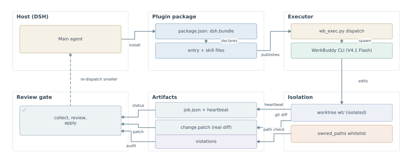
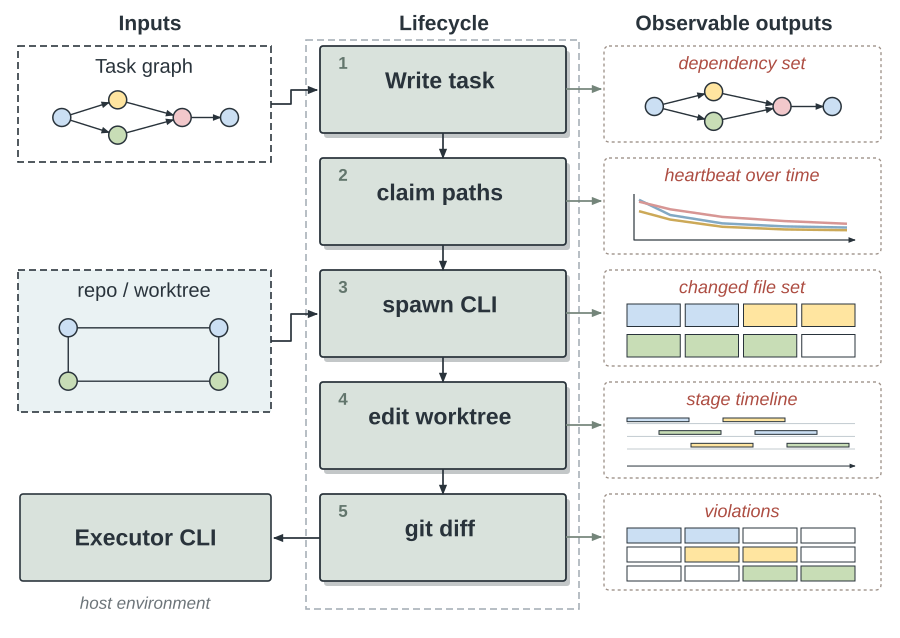
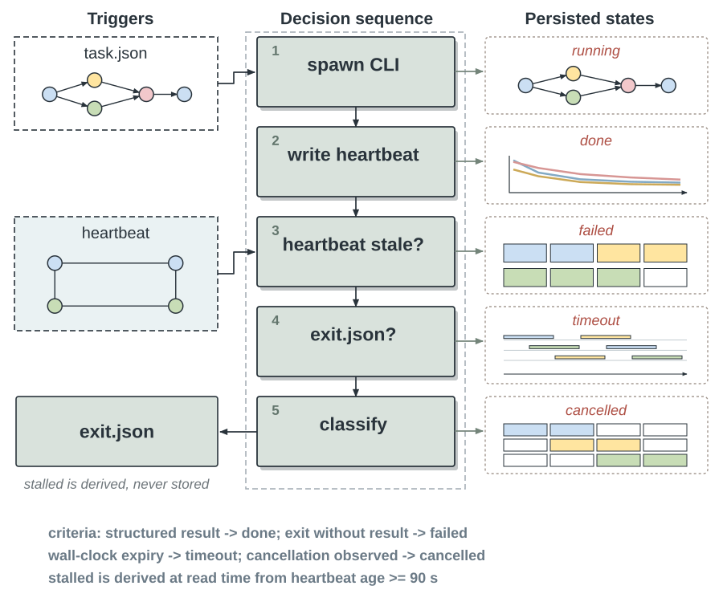
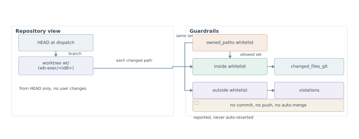

# wb-exec

> Delegate bounded implementation work to another CLI agent; keep planning, supervision and review for yourself.

`wb-exec` is a **DeepSeek Harness plugin (skill bundle)**: the host agent hands **coding / refactoring / test-writing** subtasks to a **headless WorkBuddy executor (DeepSeek V4.1 Flash, effort `max`)** and gets back a **structured result** plus the **real diff**.

> ⚠️ **Prerequisite.** The WorkBuddy / CodeBuddy CLI must be installed on the same machine. Without it the plugin installs but the skill cannot do anything: its first step, `doctor`, reports `ok=false` and stops. It never installs dependencies or rewrites configuration on its own.

**Fits:** tasks with a clear boundary that can be finished independently, with an enumerable set of files; using a cheaper executor for volume while the host only plans and reviews; work that deserves an isolated worktree, reviewed by a human before it lands.

**Does not fit:** exploratory work, requirements still moving, cross-module rewrites, or anything that needs architectural judgement. Keep those in the host.



*Figure 1. Install-time registration (top row), run-time delegation to the executor, and the audit path that returns artifacts to the review gate (bottom row, right to left).*

---

## Features

| Feature | What it does |
|---|---|
| **Path whitelist** | `owned_paths` in the task package is the set of paths the executor may touch. Changes outside it are detected and reported in `result.violations` rather than silently accepted |
| **Directory isolation** | On a Git repository the run happens in a dedicated worktree on a `wb-exec/<id8>` branch: no commit, no push, no auto-merge |
| **Real diff first** | The executor's `summary` is only its own account. `change.patch` and `changed_files_git` come from the actual `git diff`; when the two disagree, the diff wins |
| **Structured capture** | A `--json-schema` constraint forces structured output; the script then adds the git diff and the out-of-scope check to produce a machine-readable `result.json` |
| **Recursion guard** | The child process gets `WB_SUBAGENT=1`; the script refuses to dispatch when it sees that variable (exit code 3), so an executor cannot spawn another executor |
| **Non-blocking long runs** | `dispatch` returns a `job_id` immediately; `status` polls, `collect` retrieves, and both heartbeat and timeout are observable |
| **No dependencies** | Python standard library only, Python 3.10+ |

---

## How it works



*Figure 2. One delegation cycle. The host never merges on its own: review is a separate, mandatory step, and a failed attempt goes back as a smaller task package.*

1. The host writes the task package to disk as JSON (`goal`, `owned_paths`, `acceptance`, ...)
2. `dispatch` (background) or `run` (foreground) starts the call; Git repositories get a dedicated worktree by default
3. The executor works and emits stream-json events; the supervisor writes a heartbeat every 5 seconds
4. `collect` parses the structured result and merges in the real diff and the out-of-scope check
5. **The host reads the patch and runs the acceptance commands itself before integrating anything.** `wb-exec` never integrates for you

---

## Requirements

- **Python 3.10+** (standard library only, no `pip install`)
- **WorkBuddy / CodeBuddy CLI** — the script probes for a `codebuddy` executable and for the CLI embedded in a local WorkBuddy install; set `WB_CLI` to point at one explicitly
- **Git** — optional. Used for worktree isolation and diff capture; a non-Git directory degrades to in-place execution
- An account or plan that is allowed to use `deepseek-v4.1-flash`

Check the environment first:

```bash
python <SKILL_DIR>/scripts/wb_exec.py doctor
```

It returns JSON with `ok` / `cli` (the resolved entry point) / `cli_version` / `git` / `is_git_repo` / `state_root`. When `ok=false` or `cli_error` is non-empty, stop and hand the raw output to the user — do not install anything or change configuration.

---

## Install

This repository is a **DSH plugin package** (`package.json` declares `dsh.bundle`). Once installed, a `ctx.skills` provider publishes `skills/wb-exec/` as a skill.

**Option 1 — plugin market or CLI (recommended)**

Install it from **Plugins → Plugin Market** in DSH Desktop, or from a terminal:

```bash
dsh plugin --profile <profile> add github:Luminousyyh/skill-wb-exec
```

> DSH Desktop manages its own profile. A CLI install may land in `profiles/web` instead of the profile the desktop app uses; on the desktop, install through **Settings → Plugins**.

**Option 2 — use it as a plain skill (no plugin)**

Copy `skills/wb-exec/` into your agent's skills directory. The loader discovers a skill at `<skills-root>/<name>/SKILL.md`:

```bash
git clone https://github.com/Luminousyyh/skill-wb-exec.git
cp -r skill-wb-exec/skills/wb-exec ~/.agents/skills/wb-exec
```

Always invoke the script through **this skill's absolute path** rather than the terminal's current directory:

```bash
python <SKILL_DIR>/scripts/wb_exec.py <subcommand> ...
```

On Windows, if `python` is not on `PATH`, use `py -3` or the absolute path of a local Python.

---

## Quick start

### 1. Write the task package (the most important step)

Save it as a file, for example `.wb-exec/tasks/001.json`:

```json
{
  "goal": "Rate-limit failed logins on /login: lock an account for 10 minutes after 5 consecutive failures within 5 minutes, and return 429",
  "context": "The rate-limiting middleware lives in src/auth/mw.py. A Redis client wrapper already exists in src/common/redis.py; reuse it and do not create a new connection pool.",
  "inputs": ["src/auth/mw.py", "src/common/redis.py", "tests/test_auth.py"],
  "owned_paths": ["src/auth/", "tests/test_auth.py"],
  "acceptance": ["pytest -q tests/test_auth.py"],
  "notes": "Do not add dependencies. Count failures with Redis INCR + EXPIRE under the key auth:fail:<account>."
}
```

Three hard rules:

1. `goal` says what changed once the work is done, in one sentence — **no implementation steps**
2. `owned_paths` must be enumerable; **an empty list means the executor may only create new files**
3. `acceptance` holds executable commands, never "make sure it works"

### 2. Inspect the call before making it (optional)

```bash
python <SKILL_DIR>/scripts/wb_exec.py dispatch --task .wb-exec/tasks/001.json --cwd <repo> --dry-run
```

`--dry-run` prints the argv and starts nothing, which is how you check paths and flags.

### 3. Dispatch

Long jobs — most of them — go to the background:

```bash
python <SKILL_DIR>/scripts/wb_exec.py dispatch --task .wb-exec/tasks/001.json --cwd <repo>
```

Short jobs can be waited on in the foreground:

```bash
python <SKILL_DIR>/scripts/wb_exec.py run --task .wb-exec/tasks/001.json --cwd <repo> --timeout 600
```

### 4. Supervise

```bash
python <SKILL_DIR>/scripts/wb_exec.py status --job <JOB_ID>
```

- `running` — normal; look again in 30–60 seconds, never in a tight loop
- `stalled` — the heartbeat is more than 90 seconds old. `collect` first to see where it stopped, then decide whether to `cancel` and re-dispatch a smaller package
- `cancel_requested` — the cancellation flag is written; waiting for the process to exit

```bash
python <SKILL_DIR>/scripts/wb_exec.py cancel --job <JOB_ID>
```

### 5. Collect and review

```bash
python <SKILL_DIR>/scripts/wb_exec.py collect --job <JOB_ID> --wait
```

The result (excerpt):

```json
{
  "ok": true,
  "job_id": "3f9c1a7b2e04",
  "status": "done",
  "exit_code": 0,
  "elapsed_s": 42.1,
  "result": {
    "summary": "Added token validation middleware and 3 tests",
    "changed_files": ["src/auth/mw.py", "tests/test_mw.py"],
    "tests": [{"cmd": "pytest -q tests/test_mw.py", "status": "pass", "detail": "12 passed"}],
    "blockers": [],
    "artifacts": {"patch": ".../change.patch", "stdout": ".../stdout.jsonl", "stderr": ".../stderr.log"},
    "changed_files_git": ["src/auth/mw.py"],
    "violations": []
  }
}
```

**Review discipline — none of these is optional:**

1. **Read the patch yourself before judging.** `artifacts.patch` is the real diff; `summary` is only the executor's account. When they disagree, the diff wins
2. A non-empty `violations` means the executor wrote outside its assignment. Do not quietly accept it and do not revert it yourself — report it to the user first
3. A `pass` inside `tests` **is not independent verification**. After integrating, run the acceptance commands yourself in the main working tree
4. Integration belongs to the host: `git apply --check` → `git apply` → run acceptance → report. **Do not run `git commit` or `git push`** unless the user explicitly asks for it

---

## Command reference

| Subcommand | Arguments | Purpose |
|---|---|---|
| `doctor` | `[--cwd]` | Self-check: CLI, git, environment, state directory |
| `dispatch` | `--task` `[--cwd]` `[--timeout 1800]` `[--worktree auto\|off]` `[--dry-run]` | Dispatch in the background, return a `job_id` immediately |
| `run` | same, minus `--dry-run` | Run in the foreground and wait for collection |
| `status` | `--job` | Query the job state |
| `collect` | `--job` `[--wait]` `[--wait-timeout 1800]` | Collect the result; `--wait` blocks until the job ends |
| `cancel` | `--job` | Request cancellation (writes a flag file; the supervisor reacts within 0.5 s) |
| `jobs` | `[--limit 10]` | List recent jobs |

General notes:

- `--timeout` is in seconds and defaults to `1800`
- `--worktree auto` (default) creates a dedicated worktree on a Git repository; `off` runs in place
- **The executor is fixed**: WorkBuddy / DeepSeek V4.1 Flash at effort `max`, hard-coded into the script. The CLI **has no** `--model` or `--effort` flag — passing one is rejected by argparse on purpose. When the account refuses that model the run fails; **do not retry with a different model**, hand `stderr.log` to the user

---

## Task package protocol

| Field | Required | Meaning |
|---|---|---|
| `goal` | yes | The objective, without implementation steps; the script renders it into the executor prompt |
| `context` | no | Background and known constraints |
| `inputs` | no | Read-only reference material; paths are passed to the executor with `--add-dir` |
| `owned_paths` | no | **Whitelist of writable paths**; when empty only new files may be created. Always use `/` as the separator |
| `acceptance` | no | Executable commands; the executor should run them and record the outcome in `tests` |
| `notes` | no | Catch-all constraints |

`owned_paths` matching: a path qualifies when it is **exactly equal, or starts with the entry plus `/`**. `src/auth/` covers `src/auth/mw.py`; `src/auth` covers it too. Anything outside the whitelist is recorded in `result.violations`.

Full field definitions and the state machine live in [protocol.md](skills/wb-exec/references/protocol.md); a ready-to-edit template is [task.example.json](skills/wb-exec/assets/task.example.json).

---

## States and failure handling



*Figure 3. Job states. `stalled` is derived from a missing exit file, not reported by the executor.*

State machine: `running` → `done` | `failed` | `timeout` | `cancelled` | `stalled`

`stalled` is derived (`exit.json` absent and the heartbeat older than 90 seconds). The process may still be alive or already dead — `collect` first and read the tail of the output.

| Symptom | Action |
|---|---|
| `exit_code != 0` with a non-empty `blockers` | Carry the blocker back into planning, narrow or split the package, re-dispatch **once** |
| `ok=false, blockers=["could not parse structured result"]` | Read the tail of `artifacts.stdout`; usually the executor did not follow the schema. Add "the last message must be JSON" to `notes` |
| `status=timeout` | The package is too large. Split it into 2–3 packages whose `owned_paths` do not overlap |
| `status=stalled` | `collect`, then `cancel`; re-dispatch with `--worktree auto` |
| `cli_error` | Stop and report to the user; do not install dependencies |

Exit codes:

| Code | Meaning |
|---|---|
| 0 | Success |
| 1 | Execution failed, or the result could not be parsed (`collect` returns `ok=false`) |
| 3 | Recursion refused (this process is already an executor) |

---

## Safety boundaries



*Figure 4. The whitelist and the worktree are the security boundary — not a polite request inside a prompt.*

- **Directory isolation and `owned_paths` are the real security boundary, not optional extras.** The child command includes `-y`, which skips routine permission prompts (HIGH/CRITICAL cases may still ask), so isolation plus a whitelist is what actually constrains the run
- **Never recurse**: the executor is already forbidden to dispatch, and the host must not dispatch a second task over the same files while a worker is running
- **Never trigger `dispatch` from inside a WorkBuddy / CodeBuddy session**: the child process collides with that session's daemon and hangs silently — measured at 45–300 seconds with no stdout or stderr at all. Call the script from the host agent or a normal terminal
- **Never run two jobs over the same file**: `owned_paths` of concurrent jobs must not overlap; overlapping work is serialised
- **Never dump full logs at the user**: give `summary`, the relevant `tests` and `violations`; the logs stay in the `artifacts` paths for on-demand reading
- **Never re-run by hand with `-y`**: the script already handles the permission flags; bypassing it bypasses isolation and the out-of-scope check
- **Never clean up the user's worktree**: after `collect` the directory stays in place for review, and removal is the user's decision
- **In-place execution on a non-Git directory** (`isolated=false`, no diff capture) leaves `owned_paths` as the only defence — **it must be written**

---

## State directory layout

```
~/.wb-exec/jobs/<job_id>/
  job.json        task package snapshot, actual argv, cwd, worktree, timeout
  heartbeat.json  updated by the supervisor every 5 seconds
  stdout.jsonl    raw executor output (stream-json)
  stderr.log      executor log; model and permission errors usually land here
  change.patch    the real diff (Git repository with isolation enabled)
  result.json     parsed structured result
  exit.json       state, exit code, elapsed time
  cancel.request  cancellation flag
  wt/             the dedicated worktree (--worktree auto on a Git repository)
```

Override the state root with the `WB_EXEC_HOME` environment variable.

**Isolation semantics**: `--worktree auto` (default) on a Git repository creates a `wb-exec/<id8>` branch and a `wt/` worktree from the `HEAD` at dispatch time. Nothing is committed, pushed or auto-merged, and the user's uncommitted changes are **not** carried over. Removing the worktree is the user's decision; the script never deletes it.

---

## Development and testing

The tests stub the CLI, so **they run offline without WorkBuddy installed**:

```bash
python -m unittest discover -s skills/wb-exec/tests -v
# or
python skills/wb-exec/tests/test_wb_exec.py
```

Covered: WorkBuddy environment injection, a standalone CLI entry taking precedence over the embedded one, a native error result never being reported as success, and plain prose never counting as a structured success.

## Project layout

```
skill-wb-exec/
├── package.json               # plugin manifest: dsh.bundle.patch -> dsh/cordis.patch.yml
├── dsh/
│   ├── index.js               # server entry: publishes skills/wb-exec/ on ctx.skills (plain ESM, no build)
│   └── cordis.patch.yml       # inserts one row into the profile plugin tree (by package name, no relative path)
├── skills/
│   └── wb-exec/
│       ├── SKILL.md           # skill instructions: self-check, package, dispatch, supervise, collect, boundaries
│       ├── assets/
│       │   └── task.example.json     # task package template
│       ├── references/
│       │   └── protocol.md           # fields, result shape, state machine, isolation, exit codes
│       ├── scripts/
│       │   └── wb_exec.py            # every subcommand (standard library only)
│       └── tests/
│           ├── fake_cli.py           # stubbed CLI
│           └── test_wb_exec.py       # unit tests
├── docs/
│   └── figures/               # figure sources (JSON) and rendered SVG/PDF/PNG
├── LICENSE                    # MIT
└── README.md
```

## Figures

The diagrams are code-native vector files: editable SVG, PDF for print, PNG for preview. Their sources are `docs/figures/src/*.json`, rendered with the `academic-architecture-diagram` skill's layout tool. They describe the implemented mechanism; they are not a benchmark or a proof of anything.

## License

MIT — see [LICENSE](LICENSE).