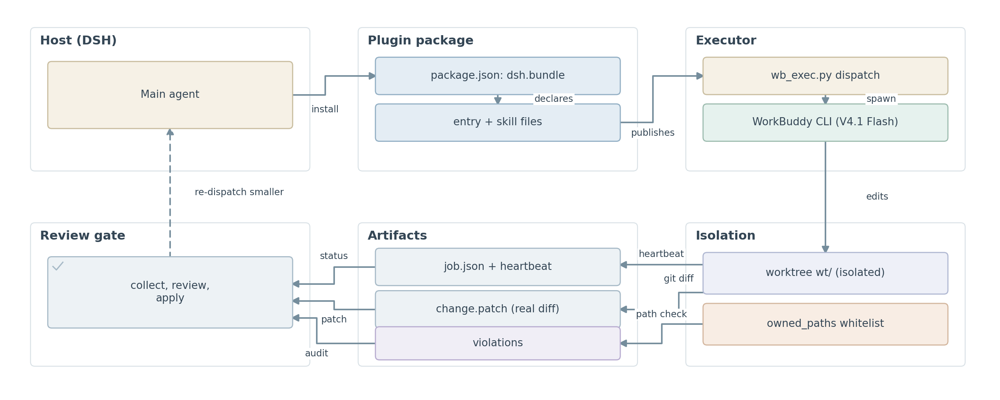
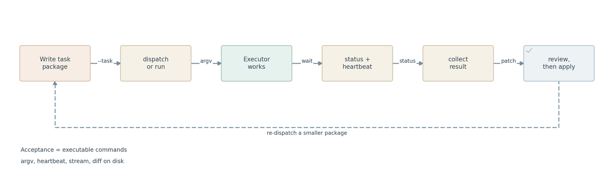
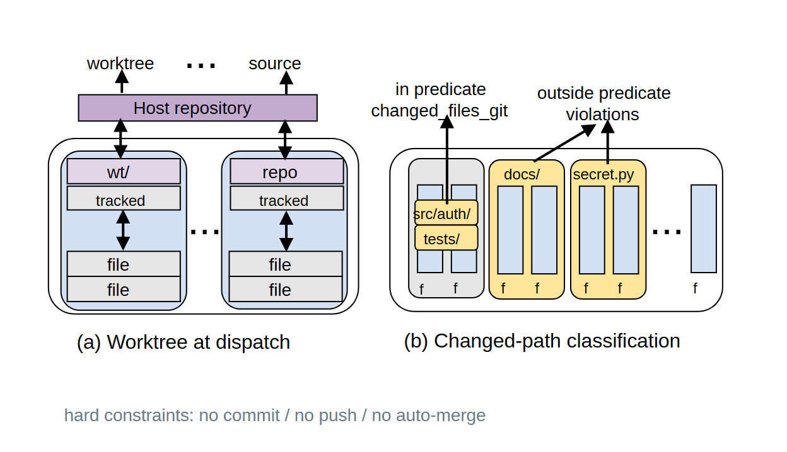
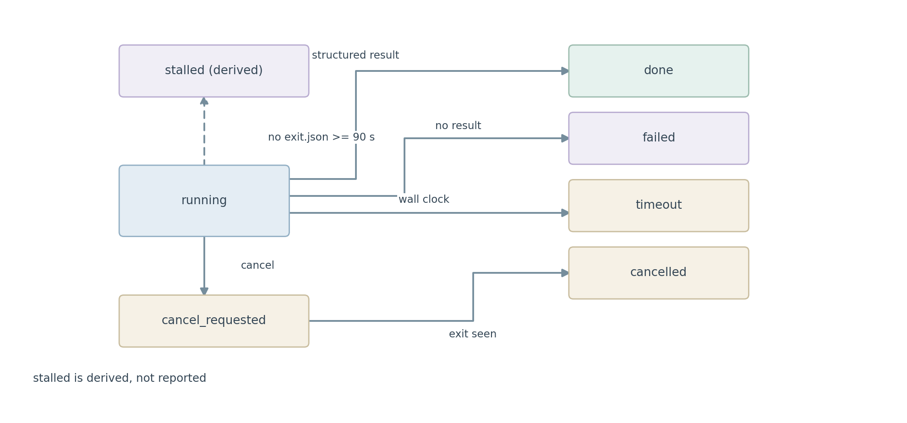

# 给编码 Agent 加一道边界：wb-exec 的设计、实现与三处真实缺陷

> 这是一份设计报告，不是推广。文中所有数字来自实测，所有缺陷都指向具体代码行。
> 仓库：<https://github.com/Luminousyyh/skill-wb-exec>（MIT）
> 版本：v1.2.1

---

## 一、问题不在于"能力不够"

我用编码 Agent 处理中等规模的改动，失败模式长期稳定在同一个地方：

**很少是"它写不出代码"。几乎总是"它顺手改了我没让它动的东西"。**

一次真实的例子：我让它给鉴权中间件加一段 token 校验。它做得很好——同时还重构了 Redis 连接池、给不相关的测试文件补了 mock、顺手格式化了三个我根本没打开过的模块。结果我花在审查上的时间，超过了我自己写那 40 行的时间。

这里有一个容易被忽略的算术：

- **生成时间**省下来了，但只是几十分钟
- **审查时间**没有省，反而增加了，因为待审查的集合从"我指定的 2 个文件"膨胀成了"它认为相关的 7 个文件"
- 而且我不敢不审——它是自己给自己判卷

所以真正的约束不是模型的代码能力，而是**可信边界**：我需要在拿到结果之前就知道"它只可能改动哪些文件"，并且在拿到结果之后能**独立验证**这个边界有没有被突破。

`wb-exec` 就是为了这件事写的。它的目标不是让 Agent 更聪明，而是让它的产出**可审计**。

---

## 二、设计：拆成两个角色、两个进程



*图 1　整体结构。上排是安装链路：`package.json` 声明 `dsh.bundle`，装载器据此把 `entry + skill files` 挂到宿主的技能表上。右上是运行链路：`dispatch` **先领走 `dispatch.lock` 里的路径（claim first），再**派生一个 CLI 执行体；执行体只在 `worktree wt/` 里改文件，并受 `owned_paths` 白名单约束。下排自右向左是审计链路：心跳、真实 git diff、越界清单、以及 `needs_human`，一并回流到审查门，由人决定合入还是重新拆一个更小的任务包。*

```
宿主 Agent（规划 + 审查）
    │  写 JSON 任务包
    ▼
wb-exec dispatch
    │  建 worktree、加锁、起子进程
    ▼
无头 CLI 执行体（WorkBuddy / codex / claude / aider / 自定义）
    │  只在这个 worktree 里改文件
    ▼
wb-exec collect
    │  真实 git diff + 越界检查 + 结构化结果
    ▼
宿主 Agent 读 patch → 人决定是否合入
```

三条不可让渡的规则：

1. **宿主永不自动合入。** 流水线停在"补丁就绪"，合入是人的动作。
2. **摘要不是证据。** 执行体自己写的 `summary` 只是它的一面之词；判据是 `git diff`。
3. **越界要报告，不要静默还原。** 静默还原会掩盖"模型理解错了任务"这个事实，而这恰恰是最需要知道的信息。

第 3 条是我最初做错的地方。第一版在成功时自动合并、失败时自动 `git checkout`——两个都是 bug。自动合并等于让写代码的和判卷的是同一个人；自动还原则把"它跑偏了"这个信号擦掉了。

---

## 三、机制：六个可检验的约束



*图 2　一次委派的生命周期。从写任务包到 review，是一个单向流程；右下那条虚线是唯一的回路——审查不通过时不是"让同一个 Agent 再试一次"，而是重新拆一个更小的任务包。左下角两条是这套设计的地基：`acceptance` 必须是可执行命令而不是散文；argv、心跳、流式输出和 diff 全部落盘，所以事后可复核。*

每个约束都能落到具体代码上，不是设计意图，是现在的行为。

### 3.1 白名单 `owned_paths` 与前缀匹配

任务包里 `owned_paths` 是可写路径的集合。实现只有几行：

```python
def violations(changed: list[str], owned: list[str]) -> list[str]:
    if not owned:
        return []
    patterns = [o.strip().rstrip("/") for o in owned if o.strip()]
    bad = []
    for name in changed:
        name = name.replace("\\", "/")
        if not any(name == p or name.startswith(p + "/") for p in patterns):
            bad.append(name)
    return bad
```

关键在 `name == p or name.startswith(p + "/")` 这一行。

**直觉写法是 `name.startswith(p)`，那是错的。** 因为 `"src/authz/x.py".startswith("src/auth")` 为 `True`——前缀不是路径边界。加了 `/` 之后，`src/auth` 与 `src/authz` 才真正分开。这条有专门的测试守着（`test_prefix_is_not_a_path_boundary`）。

Windows 的反斜杠先归一化成 `/`，所以 `src\auth\x.py` 与 `src/auth/x.py` 判定一致（`test_windows_separators_are_normalised`）。

### 3.2 从派发时的 HEAD 建一次性 worktree

Git 仓库默认 `--worktree auto`：

```python
branch = f"wb-exec/{job_id[:8]}"
proc = git(["worktree", "add", "-b", branch, str(wt), "HEAD"], repo)
```

三个细节：

- 分支基于**派发那一刻的 `HEAD`**，不是工作区当前状态
- **未提交的改动不会带过去**——这是有意的：你的半成品不应该混进别人的任务
- 脚本**从不删除** worktree。清理是你的决定，因为它可能还留着你想看的东西

于是 `collect` 里的 diff 天然是干净的：`wt` 与 `HEAD` 之间只有执行体做的事。



*图 3　隔离与越界检查。左边：worktree 从**派发时刻的 HEAD** 建出，所以未提交改动不会跟着进去——"from HEAD only, no user changes" 这一句是整个隔离性质的前提。右边：每个被改动的路径都要过白名单这一关，界内的进 `changed_files_git`，界外的进 `violations`；界外的处理是**报告**，不是自动回滚（"reported, never auto-reverted"）。最下面一行是三条硬约束：不 commit、不 push、不自动合入。*

*注意这张图画的是**白名单非空**的情形。`owned_paths` 为空时 `violations()` 会在第一行直接返回 `[]`，这一关根本不执行——这正是缺陷 1。*

### 3.3 真实 diff，而不是摘要

`collect` 会用 `git diff` 得到 `changed_files_git` 和 `change.patch`，然后：

- `summary` —— 执行体自述
- `changed_files_git` —— 来自真实 diff

两者不一致时，**diff 胜**。这就是为什么两个都要留着。

有一个容易踩的细节写在 `protocol.md` 里：如果 `isolated=false`（非 Git 目录，退化为原地执行），那 `changed_files_git` 为空表示 **"未知"**，不是"没有改动"。把"没有数据"读成"没有问题"，是这类工具最危险的错误。

### 3.4 递归防护

子进程会拿到环境变量 `WB_SUBAGENT=1`，而脚本看到它就拒绝再派发：

```
$ WB_SUBAGENT=1 python wb_exec.py dispatch --task ...
{"ok": false, "error": "RECURSION_BLOCKED"}
exit code 3
```

动机很朴素：执行体如果还能再派发一个执行体，那我就不再知道实际有多少进程在改我的文件了。这个约束也让"不要这样做"从一句口头约定变成了机械保证。

### 3.5 路径级派发锁

两个作业同时改同一批文件会互相踩。所以 `dispatch` 在**建 worktree 之前**先占 `owned_paths`：

```
$ python wb_exec.py dispatch --task b.json
{"ok": false, "error": "PATHS_LOCKED",
 "holders": [{"job_id": "a1b2c3d4", "owned_paths": ["src/auth/"]}]}
exit code 4
```

设计取舍：

- **不排队，直接拒绝。** 排队意味着我要猜"你什么时候有空"，而人需要立刻知道冲突。
- **不相交的路径照常并行**——这是能做的事，没理由拦。
- **死作业的占用会自动清掉**：靠 `heartbeat.json` 是否还在、`exit.json` 是否已写来判断。否则一次崩溃就能把路径永久锁死。

锁用一个 `.guard` 侧车文件做互斥，避免两个进程同时改 `dispatch.lock`。

**它明确不是安全边界**，只是合作进程之间的建议性约定。运行在你用户权限下的进程想绕过它，随时可以绕。这一点我在 README 里写死了，免得有人拿它当沙箱。

### 3.6 `needs_human`：把"要人来决定"变成字段

最容易被含糊处理的一件事是：这次运行到底需不需要人介入？

靠读 `summary` 的措辞来判断是不可靠的——那等于又把判断权交回给执行体的文风。所以这里只从结构化字段推导：

```python
reasons = []
if status == "timeout":   reasons.append("timeout")
elif status == "cancelled": reasons.append("cancelled")
elif status == "failed":    reasons.append("failed")
if bad:                     reasons.append("out_of_scope_writes")
if result.get("blockers"):  reasons.append("blocked")
if failed_tests:            reasons.append("failing_tests")

return {"required": bool(reasons), "reasons": reasons}
```

于是宿主可以只看一个布尔值决定要不要打断人，而不是每次都把摘要念一遍。

注意一个刻意的选择：**光有通过的测试不算通过验收**。`tests` 里的 `pass` 是执行体自己跑的结果，不是独立验证；合入之后仍要在主工作区跑一遍 acceptance。

---

## 四、实测数字



*图 4　状态机。`running` 是唯一"在跑"的状态，四个终态各有明确判据：拿到结构化结果 → `done`；进程退出但没有结果 → `failed`；挂钟超时 → `timeout`；取消被看到 → `cancelled`。左上角 `stalled (derived)` 是**推导**出来的，不落盘也不上报——它只是"90 秒没心跳"的一个视图，而不是第五种状态。*

| 项 | 值 | 说明 |
|---|---|---|
| 测试数 | **44**（+3 subtests） | 全程离线，不调用模型 |
| 测试耗时 | ~8 s | |
| 代码行数 | **1181** 行 | 纯标准库，Python 3.10+ |
| 打包体积 | **429.1 kB** / 37 文件 | 大头是 4 张矢量图的 PNG |
| 执行体后端 | **5** | workbuddy（默认）/ codex / claude / aider / custom |
| 默认超时 | 1800 s | 心跳每 5 s 写一次，90 s 无心跳判 `stalled` |
| 退出码 | 0 / 1 / 3 / 4 | 见下文缺陷 2 |

测试刻意分成四组，覆盖面不同：

- **单元测试**：环境注入、独立 CLI 优先于内嵌 CLI、原生错误不被当成成功、纯文本不被当成结构化成功，以及一个**逐字节钉住 WorkBuddy argv** 的测试——防止重构悄悄改了默认请求
- **锁测试**：重叠拒绝、嵌套拒绝、前缀不是边界、Windows 分隔符归一、不相交放行、死作业清理
- **`needs_human` 测试**：干净成功不需要人；失败、越界、阻塞、测试失败各自触发；单独测试通过不算
- **端到端测试**：对着真实临时 Git 仓库跑完整 `dispatch → status → collect`

---

## 五、三处真实缺陷

报告如果只列优点，就没有信息量。以下都是**现在仍然存在**或**曾经存在**的问题。

### 缺陷 1：`owned_paths` 为空时，文档给了三种互相矛盾的含义（仍然存在）

三处文档的说法：

| 出处 | 说法 |
|---|---|
| `README.md:125` | 空列表意味着执行体**只能新建文件** |
| `SKILL.md:33` | 同上 |
| `protocol.md:21` | 同上 |
| `protocol.md:61` | 空列表视为"**可能碰到任何东西**"，因此与所有作业冲突 |

而代码里只有一条：

```python
if not owned:
    return []          # 什么都不检查
```

实测（调用真实函数）：

```
empty whitelist, EXISTING file modified      []      ← 已存在文件被改，不报
empty whitelist, NEW file added              []      ← 新建文件，不报
non-empty whitelist, out of scope            ['secret.py']
```

**所以"只能新建文件"这条约束根本没有实现。** 空列表的实际语义是"不检查"。

这不是能被忽略的措辞问题：如果使用者相信"空列表 + 只允许新建"是安全的（比如任务包只写 `owned_paths: []` 就交付），他会得到一个**完全不设防**的运行，而且结果里 `violations` 是 `[]`，看起来一切正常。

三种可能的修法，各有代价：

1. 实现它——空列表时把已存在的被改文件报为越界。需要额外拿一份"改动前已存在的文件清单"
2. 改文档——承认空列表等于关闭检查，并把 `violations: []` 在此时标注为"未检查"而非"干净"
3. 直接禁止空列表——强制至少给一个路径

我倾向 2 或 3（3 最诚实），但没在这版改，因为 1 会改变默认行为，而"不悄悄改变别人的既有请求"是这个项目自己的原则。**先把矛盾摆出来，比急着自洽更重要。**

### 缺陷 2：README 退出码表漏了 4（仍然存在）

`README.md:283` 的表格只有三行：

| Code | Meaning |
|---|---|
| 0 | Success |
| 1 | Execution failed, or the result could not be parsed |
| 3 | Recursion refused |

但同一份 README 的第 300 行写着 dispatch 会以 `4` 退出（`PATHS_LOCKED`）。

**表格与正文自相矛盾。** 一个按表格写 `if code == 1` 处理失败的调用方，会把锁冲突误判成执行失败，然后做错误的重试。

### 缺陷 3：端到端测试第一次跑起来，抓出了三个真 bug（已修）

加 e2e 之前，36 个测试里的前 30 个全是单元测试——每个函数单独看都对。把它们串起来跑，立刻暴露：

1. **干净运行反而崩。** `result["violations"]` 只在有越界时才写，干净运行时这个键不存在，但 `protocol.md` 明写"该字段永远存在"。结果是：越界的运行正常返回，正常的运行 `KeyError`。
2. **`collect` 不报 `isolated`。** 文档要求宿主根据它判断"空 diff 是没改动还是没数据"，但信封里没这个字段。
3. **`--dry-run` 会创建 job 目录。** 它宣称"只打印 argv、什么都不启动"，实际上建了目录。这违反了 `--dry-run` 的全部意义。

三个都是**只有集成才会暴露**的问题，而且第 1 个的失败方向很讽刺：越界时能拿到结果，一切正常时反而拿不到。

这件事本身也是结论：**单元测试全绿，不等于能用。**

---

## 六、明确不做的十一件事

以下每一条都被认真考虑过并否决，理由写在 `references/rejected-designs.md`：

| 不做 | 因为 |
|---|---|
| 调度器 | 重试是关于"这份改动还要不要"的判断；静默重试可能重复一个你已经否决的改动 |
| 自动合入器 | 既写又判的 Agent 什么也没验证 |
| 沙箱 | 以你的用户权限运行的进程，能碰到你所有能碰的东西。这是隔离，不是隔离执行 |
| 模型切换器 | 钉住执行体让结果可比，也断了"换个模型试试"这条不读 `stderr.log` 的退路 |
| 从自由文本猜测 | `needs_human` 只从结构化字段来 |
| 跨项目协调 | 单机、单 `WB_EXEC_HOME` 作用域 |
| 静默扩大范围 | 越界只报告，不自动修 |
| 自动清理 worktree | 里面可能有你想看的东西 |
| 对 diff 给"第二意见" | 那又是一个 Agent 在判卷 |
| 配置文件 | 环境变量和命令行参数已经够了，多一份配置多一个漂移源 |
| 插件自带的执行体 | 执行体本来就是外部 CLI，包一层只会让它更难排查 |

---

## 七、它不适合什么

诚实地说清楚边界，比多列三条优点有用：

- **探索性任务**——"你觉得该怎么改"这种，它的前提是任务边界已定
- **需求还在变**——任务包写完需求就变了，重写包的成本高于直接做
- **跨模块重构**——`owned_paths` 会变得跟整个仓库一样大，白名单就没意义了
- **需要架构判断**——它不做决定，只执行

它真正的适用面很窄：**边界清楚、文件可枚举、能独立完成、值得进一次性 worktree 并被人工审查的任务。** 这个面比"AI 写代码"小得多，但在这个面里，我敢让它自己跑。

还有一条环境限制值得写下来：**不要在 WorkBuddy / CodeBuddy 会话内部触发 `dispatch`**。子进程会和那个会话的 daemon 抢资源，静默挂住——实测 45 到 300 秒，stdout 和 stderr 一个字都没有。这类"没有任何输出就卡住"的失败，比报错难查得多。从宿主 Agent 或普通终端调用。

---

## 八、关于验证

所有测试**不装任何依赖、不调用任何模型**：`tests/fake_cli.py` 回放一段 stream-json 转录，所以整套离线可跑。

```bash
python -m unittest discover -s skills/wb-exec/tests -v
```

我没有把 CI 徽章放在 README 里。原因很简单：这个仓库当前**跑不了 GitHub Actions**（账号层面的限制，与工作流配置无关——手动触发时 API 明确返回 `Actions has been disabled for this user`）。加一个永远灰着的徽章，比不加更糟。测试的可信度来自它能在你机器上一条命令跑完并且真的跑通，不来自一个图标。

---

## 九、一句话总结

> 让另一个 Agent 改你的代码，最需要的不是它更聪明，而是**它的产出可被独立审计**：改动范围事先可枚举、事后可验证、越界会报告、合入由人决定。

`wb-exec` 就做了这件事，1092 行，纯标准库。它有三个已知缺陷，其中一个（`owned_paths` 为空的语义）我建议你在使用前先看清楚。

---

*仓库：<https://github.com/Luminousyyh/skill-wb-exec> · MIT · Python 3.10+*
